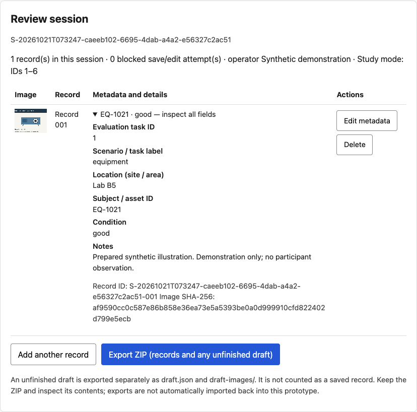
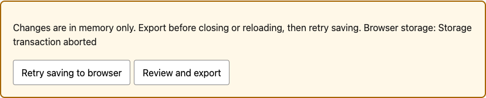

# UI design for data collection

HLL-04 · EE4080 · Working report

SHUM Ho Yin · Student ID 56317378

Supervisor: Li Haoliang · Assessor: Sun Yanni

Revision date: 26 October 2026, incorporating a separate remote-study instrument and dated engineering verification. The submitted InfoNet abstract proposes a generic industrial data-collection interface. The image-and-metadata workflow is the adopted working scope. Remote v3 is the primary planned comparison; partner-specific acceptance requirements remain unconfirmed. The 26 October revision also expands the literature review and design rationale. Human evaluation results are not supplied for this report. Engineering evidence and its limitations are reported separately from the planned comparison.

## Abstract

This project develops a guided browser interface for collecting images with structured metadata. The contribution combines validation, correction, review, recoverable storage and an independently checkable export. The primary planned evaluation is a paired remote v3 comparison between the guided interface and a basic browser table, using six prepared image-and-metadata tasks per condition. The frozen desktop v2 build and its earlier folder-and-spreadsheet protocol are retained as engineering history and an alternative demonstration. Published human studies support visible format rules, adjacent error feedback and structured entry, with mixed timing and satisfaction effects; none directly evaluates this prototype. These findings informed remote revision research-20261026-r1, which first displays validation errors on Save and preserves feedback while errors are corrected. Session and export identities distinguish this revision from legacy sessions. Automated checks cover validation, revision integrity, recovery and complete paired workflows; earlier hosted synthetic walkthroughs verified downloaded archives and acknowledged metadata submission. These are engineering results. No human participant observations are supplied, so completeness, accuracy, image association, completion time and perceived usability remain outcomes for the planned comparison.

## 1 Introduction and background

### 1.1 Project context

The assigned project title is “UI design for data collection”. The problem addressed in this draft is how an operator can collect an image together with the information needed to interpret it, inspect the resulting record, and transfer both parts without losing their association. The title allows several possible applications. This implementation selects a small images-and-metadata workflow so that the interface and its failure modes can be examined concretely. It does not establish that this is the industrial partner’s approved workflow.

Current project notes identify the work as an industrial project supervised by Li Haoliang, with Ken Ching and Steve Ng introduced as industrial contacts. The latest abstract prepared for InfoNet proposes guided data collection in an industrial setting, integrating capture or import, metadata entry, review and export. The student reports submitting that version. It does not specify smart mobility or a particular company application. The present image workflow is a concrete implementation choice within that proposal, not partner approval. The available material does not confirm partner-specific data types, devices, export specifications, deployment conditions or acceptance criteria. The browser images-and-metadata implementation is the starting point for that discussion, not evidence of a deployed industrial system.

The earlier forensic-recapture direction is not retained as the default application. The present prototype neither detects recaptured images nor trains an artificial-intelligence model. Its engineering focus is the interaction between acquisition, metadata entry, validation, review, and export. This narrower boundary permits useful implementation and testing while stakeholder alignment remains incomplete. Any later change of application must be recorded as a requirements revision rather than silently presented as the original approved objective.

### 1.2 Problem definition

An image file alone does not express all of the contextual information that this proposed workflow requires. The prototype records a scenario, location description, subject or asset identifier, and condition, with optional notes. When images and metadata are maintained in separate tools, the operator must also maintain their association. A record can therefore fail in several distinct ways: required information can be absent, a value can violate its expected format, a plausible value can be factually wrong, or the metadata can refer to the wrong image. These are the failure categories to investigate, not measured prevalence claims about an industrial workforce.

A required-field gate addresses only part of this problem. It can refuse an empty location or an identifier with an invalid syntax, but it cannot determine whether an operator selected the correct location or photographed the intended object. Likewise, a SHA-256 digest can support byte-level comparison of image files, but cannot certify the truth of a scene description. The central design problem is therefore not simply to force the completion of a form. It is to make the full collection task understandable and recoverable while preserving a checkable relationship between files and records.

The primary research question is: for a defined images-and-metadata task, how does the guided remote v3 interface compare with a basic browser table in metadata completeness, metadata accuracy, format errors, image association, successful export and task completion time? Perceived usability and difficulties during correction or recovery provide further outcomes. Section 3.5 defines this paired comparison. The earlier desktop v2 folder-and-spreadsheet protocol is retained as a historical or alternative design, rather than the main planned study. Neither design tests superiority over established data-collection platforms.

### 1.3 Established collection systems and the contribution boundary

Open Data Kit (ODK) is a direct precedent, not a tool to dismiss as post-capture labelling software. Hartung and colleagues describe an extensible suite comprising Collect, Aggregate, Voice, and Build. Collect supports application logic and several data types, while Aggregate supports storage and transfer; the paper presents modularity and composition as central architectural decisions.[1] The frozen desktop v2 prototype adopts a much smaller boundary: a browser interface and a locally generated export, without a server-side collection platform. The separate remote v3 instrument adds a purpose-limited metadata collection service, described in Section 2.11; it is not an industrial deployment or a comparison against ODK.

ODK’s current official documentation explicitly describes required responses and constraints. A required question can prevent advancement without an answer, and a constraint can restrict the values accepted for a response.[2] It would therefore be inaccurate to claim that existing systems lack collection-time validation, or that required-field validation is a new invention of this project. The literature and documentation instead establish that structured capture and validation are mature design possibilities.

The contribution proposed here is the design, implementation, and evaluation of a constrained workflow, including its schema, error feedback, review behaviour, and export association. A useful outcome would be an evidence-backed account of which design choices worked for the selected task, which did not, and what trade-offs appeared. Even if a future study shows improvement over the basic workflow, it would not demonstrate superiority over ODK: ODK is not an experimental condition in the present plan. The decision to build a small custom prototype also carries an opportunity cost, because capabilities available in established platforms must otherwise be implemented and tested locally.

### 1.4 Form design and error feedback

Bargas-Avila and colleagues provide a set of twenty guidelines for web-form design. Relevant recommendations include asking only for necessary information, clearly distinguishing required and optional fields, restricting choices where appropriate, explaining format requirements, and retaining completed entries after an error.[3] These recommendations offer a basis for reviewing the prototype, rather than a certificate that its interface is usable. The chapter itself distinguishes empirical support from recommendations based on expert practice.[3]

Several current choices broadly follow those recommendations. The metadata form has a limited set of fields, optional notes are labelled, scenario and condition are constrained choices, and the identifier hint states the accepted structure. After a rejected save, values remain available for correction. Nevertheless, the correspondence is incomplete. The chapter’s guideline 10 recommends radio buttons for up to four alternatives, whereas the prototype uses a drop-down for its four condition values. Guideline 13 recommends a format specification without an additional example, whereas the current identifier hint includes both a rule and an example.[3] These differences are design decisions to examine, not grounds for claiming complete compliance.

Seckler and colleagues tested whether those guidelines change behaviour when applied together.[8] Sixty-five participants used three reconstructed real-world registration forms in a between-subject design, with 32 assigned to the original versions and 33 to versions improved according to the twenty guidelines. Mean completion time fell from 113 to 85 seconds for the Sueddeutsche form and from 105 to 70 seconds for the NZZ form, both significant differences. The Spiegel form fell from 104 to 85 seconds, but that time difference was not significant. All three improved forms required fewer submission trials, while satisfaction effects varied by form and questionnaire scale.[8] The study therefore supports treating the guidelines as a coherent package worth applying and testing. Because the changes were introduced as a bundle, it cannot show that one feature, such as required-field marking or error placement, caused the gains. Registration forms also differ from copying task labels and attaching the correct image.

Two narrower studies address feedback content and placement. In an experiment with 166 participants and four conditions for advance format guidance, giving format details before entry reduced errors and submission trials; an explicit rule was the most efficient presentation, and adding an example produced no further benefit.[9] This is relevant to the subject-identifier pattern, the field most exposed to format errors in the present schema. It supports a visible rule, but it does not show that the current added example is harmful. A study of 303 participants compared six error-message locations. Messages near the erroneous field produced better performance than messages at the top or bottom of the form, and the right-hand location was rated most satisfying and intuitive.[10] The prototype keeps error text beside the relevant input, which is consistent with the near-field result but is not a test of the right-hand layout. Only the abstracts of [9] and [10] were checked for this report, so no effect sizes are drawn from them. Location evidence also says nothing about when an error should first appear.

Validation timing needs particular care. Guideline 16 recommends presenting errors together after the form has been completed and sent; its discussion reports that the earlier error-timing study found problems with feedback appearing when an erroneous field was left.[3] That primary study reported two experiments, with 77 and 90 undergraduate participants, in which forms contained artificial format obstacles that were not disclosed in advance.[13] In the second study, the mean number of repeated errors was 3.48 when all errors were shown after submission, 3.17 when they were shown one at a time after submission, and 7.25 with feedback on blur. The overall difference was significant at p < .03, whereas completion times did not differ significantly.[13] The result supports testing a less interruptive design in which first errors appear at an explicit save. It does not establish one optimal timing for every form. Its undisclosed obstacles differ from the present schema, where rules and required markers are visible before entry.

The frozen desktop v2 implementation validates on blur and then updates feedback during edits once the field has been touched, as well as validating on save. The original remote v3 guided condition reuses that behaviour. Neither the guideline chapter nor the timing study is direct proof that this blur behaviour is best or worst for the present task. The design combines early correction opportunities with a final save gate, but this combination remains an empirical question. A later iteration could compare save-only and blur-plus-save feedback while holding the other workflow features constant. Section 2.12 records the implemented, separately identified remote revision informed by this evidence; desktop v2 remains unchanged.

### 1.5 Evidence from structured data-capture evaluations

Evaluations of electronic data capture provide indirect evidence about checked, structured entry. Zeleke and colleagues conducted a randomized crossover comparison in a health and demographic surveillance site, in which 12 interviewers collected 1246 questionnaires with each method. Paper and electronic records came from paired simultaneous interviews, with the order of tools randomized.[11] The overall item error rate was 1.67% on paper and 0.60% electronically, and the proportion of questionnaires containing at least one error was 41.89% and 30.89% respectively.[11] The electronic forms, built with ODK, used number, date and skip checks, allowed editing, and required only identifiers.[11] The result supports the general plausibility that collection-time checks reduce some data-entry errors. It cannot be assigned to one interface mechanism, its observations come from 12 interviewers rather than 1246 independent interface users, and its comparator was paper rather than a browser table. It therefore informs the hypotheses below without predicting the size of any difference in this project.

A recent randomized crossover study by Nakamura and colleagues compared two clinical registry data-entry interfaces with 20 therapists performing simulated registry tasks.[12] The tested wizard interface was associated with shorter completion times, fewer errors and lower NASA-TLX workload. Navigation and input methods also differed between the interfaces, and the authors explicitly caution against concluding that wizard designs are generally superior.[12] Only the early-access abstract was checked here, so no magnitude is reported. The study is useful as recent support for evaluating stepwise structured entry with paired task measures, not as proof for a guided image workflow.

Taken together, the external studies agree on a modest point: in their tested settings, visible rules, near-field feedback, collection-time checks and structured sequencing were associated with fewer errors or submission trials, while effects on time and satisfaction were less consistent. Their limits are equally consistent. Most tested bundles of changes, the participants and tasks differ from this project, and none evaluates the association between an image and its metadata. Hash matching and explicit image selection in this prototype are therefore engineering controls whose human benefit has not been studied by the cited work. These findings were obtained from external participants. They are distinct from this project's synthetic engineering observations, and they cannot substitute for the planned paired comparison.

### 1.6 Objectives and scope

The first objective is to make the proposed task explicit through a small schema and an understandable sequence of screens. The second is to implement capture or import, validation, session review, and a transferable package of images and metadata. The third is to produce reproducible engineering evidence for selected behaviours and to identify failures that the existing tests miss. The fourth is to prepare a fair, feasible comparative evaluation without presenting planned observations as completed results.

The frozen desktop v2 scope includes a single browser session, operator and device descriptions, one image per record, manually supplied metadata, local persistence, and ZIP export containing a CSV and JSON manifest. It excludes server synchronisation, multi-user access control, long-running sensor acquisition, automatic location verification, model training, and production integration. Its static HTTPS deployment on AWS Amplify keeps collection data in browser storage. The separate remote v3 instrument adds consent, condition allocation, timed practice and task blocks, questionnaires, and authenticated metadata checkpoints to private AWS storage. It uses prepared fictional images and uploads their selected hashes rather than image contents. It does not add field acquisition, collaborative collection or partner integration. Browser camera paths have synthetic engineering coverage; physical cameras, phones and field use remain unverified. The student reports that the hardware description was general and no specific device was assigned. Partner-specific integration requirements remain unconfirmed.

A successful engineering prototype would preserve valid records and their image associations, reject the intended invalid inputs with recoverable feedback, and export an independently readable package. A successful evaluation would go further: it would establish the task conditions, preserve raw observations, score outcomes consistently, and explain uncertainty. At present, the work has stronger evidence for selected software behaviours than for user benefit. The following methodology maintains that distinction.

## 2 Methodology and implementation

### 2.1 Approach and evidence provenance

The methodology combines a scoped software prototype, automated functional tests, failure-path tests, independent inspection of exported files and a planned human comparison. The original repository baseline is commit 9b58d081b8cfda492442a392fd4f9c0b407aa753. The 21 October revised implementation is identified by source hashes retained with its verification evidence. The original baseline commit does not identify the repaired source by itself. A public repository baseline was subsequently recorded on 26 October at commit 07fb045 before the updates described here.

Two development and repair rounds are kept distinct, followed by the deployment verification reported in Sections 4.13–4.14. The 16 October engineering run used localStorage and three synthetic mobility-labelled task cards. It remains a historical example of validation versus accuracy. The 21 October audit found further failures that the earlier checks did not cover, including destructive resume cancellation, draft loss, absent direct editing, hidden review metadata and evaluation bookkeeping errors. The subsequent repair changes both the application and the evaluation instruments. Earlier passing checks do not invalidate later counterexamples, and the revised report does not erase the defects from the project history.

The requirements in this chapter are prototype requirements. They specify behavior that can be checked without pretending to have a detailed industrial acceptance specification. Requirements concerning retention, task identity and export are necessary to make a later comparison interpretable; the choice of metadata and the usefulness of the workflow remain subject to stakeholder and user evaluation.

### 2.2 Frozen desktop v2 architecture and responsibilities

The desktop v2 application consists of static HTML, CSS and JavaScript modules. It can run from the local server used during development or from the verified AWS Amplify HTTPS deployment. Neither launch method adds a collection backend or automatic image upload. The browser controller handles navigation, file processing, draft state and feedback. A pure-logic module contains the schema, validation, record creation, update rules, CSV serialization, manifest generation and ZIP construction. A separate persistence module reads and writes a single state envelope in IndexedDB.

Table 1. Prototype components and verification responsibilities

| Component | Responsibility | Verification boundary |
|---|---|---|
| HTML and CSS | Screens, labelled fields, review controls and responsive layout | Actual browser interaction and rendered screenshots |
| Browser controller | Import, camera request, draft lifecycle, persistence status and export initiation | Desktop Chrome import and failure-path checks; physical camera unverified |
| Core logic | Schema, record gates, stable identity, update history and serialization | Node regressions plus actual downloaded archive checks |
| IndexedDB adapter | Atomic state writes and transaction-completion acknowledgement | Browser commit, abort, migration and reload cases |
| Evaluation tools | Explicit task matching, archive checks, complete-pair analysis | Synthetic instrument fixtures; no human outcomes |

The separation supports tests at appropriate levels. A unit test containing a dummy image digest can check a duplicate gate, but it cannot demonstrate that an imported image was decoded or that the digest matches actual bytes. Those questions are checked through the browser and independent ZIP readback. Likewise, a correctly computed SUS value from artificial ratings checks the formula, not the usability of the interface.

The state envelope combines the session, any unfinished draft and relevant navigation state. A full snapshot is written transactionally so that records and their associated draft state are not committed in unrelated steps. This is a deliberate bounded-prototype trade-off: it simplifies atomic recovery, but each snapshot rewrites more data than a normalized store of individual image blobs would. The tested workload and limits are therefore reported explicitly rather than extrapolated to arbitrarily large collections.

### 2.3 Session and draft lifecycle

A session begins with an operator name and a device description. The default device text comes from the browser user-agent string and is not a verified hardware identifier. Session identifiers contain a random component to reduce collisions, while record identifiers use a monotonically increasing session counter. Deleted records and rejected attempts do not cause an earlier successful record identity to be recycled.

When stored work exists, startup presents explicit resume, export and discard choices. Cancelling resume does not delete the stored state or silently replace it with a new session. Discard is a separate confirmed action. The old data must remain accessible until that destructive choice has been made and its storage update has completed. This design directly addresses the earlier failure in which declining a browser confirmation removed the sole saved session.

An imported image and partially entered metadata belong to a recoverable draft. Moving to review does not imply abandoning that draft. Returning to collection can continue it, while deliberate discard is explicit. Draft autosaves are debounced and pending writes are exposed in the status. Leaving the page while a write is pending or failed should not be presented as safe merely because the fields are visible. After a successful commit, reload restores the draft rather than silently starting an empty record.

A draft is not a completed study task. Recovery exports keep unfinished draft information separate from the completed-record dataset. This prevents partial work from being counted as an additional successful task while still preserving the operator's opportunity to recover it. The separation is also important for an edit draft: cancelling an edit returns to the previously saved record metadata, whereas saving a validated edit updates that same record identity.

### 2.4 Image processing and asynchronous interaction

The import path accepts decoded PNG, JPEG and WebP images within the displayed per-file bound. File type and byte count alone are insufficient, so an image must decode before it replaces the previous valid image. A failed replacement retains the earlier draft. The controller computes SHA-256 from the imported bytes and uses that digest for duplicate detection and later export verification.

Image processing is asynchronous. A user can select another file or leave the screen before decoding and hashing finish. The controller therefore associates a request with the active draft and ignores stale completion results. Without that guard, an older request could overwrite a newer choice or attach an image to the wrong draft. The tests use controlled overlapping imports to check this state boundary rather than assuming network-free processing is instantaneous.

Camera access is implemented through the browser's media API. A captured video frame is drawn to a canvas and encoded as JPEG. This path creates a newly encoded image and is not claimed to preserve camera EXIF metadata. The hosting tests exercised denied permission and synthetic camera capture through the native browser APIs. These checks used a known artificial video device, not a physical camera. Physical camera behaviour, permission handling on target phones and image quality under field conditions remain unverified. The planned human comparison continues to use prepared-file import in desktop Chrome.

### 2.5 Metadata validation and correction

The schema requires scenario, location, subject or asset identifier, and condition. Notes are optional and limited to five hundred characters. Scenario and condition use listed options; the identifier must contain two to four capital letters, a dash and three to six digits. These constraints are selected prototype rules, not a universal industrial data standard.

Validation reports missing or malformed values, retains entered content and checks the whole record before saving. A save rejection and a successful save are logged differently. Inline feedback is associated with the field through descriptive labels and error text. This supports error explanation but does not prove screen-reader accessibility or show that blur-time validation is the best timing choice. Those remain separate questions for observation and testing.

Ordinary collection permits an omitted evaluation task ID, but supplied IDs must be unique within a session. Study mode requires one of the frozen six task IDs and prevents a second record from claiming the same task. Edit validation excludes the record being edited from the duplicate search. Thus a record can retain its own ID while a proposed collision with another record is rejected. The evaluation scorer independently checks explicit identity; it never substitutes row order for missing IDs.

Review exposes all saved metadata, including task ID and notes, and provides direct editing. A successful edit preserves the record ID, image bytes and original record timestamp while recording the update in the event history. Validation applies to edits as well as initial saves. This permits a format-valid but factually wrong condition to be corrected without deleting and recollecting the image. It does not mean that the interface detects the factual error automatically.

The duplicate-image rule is byte-oriented. Re-importing the same bytes can be detected, but a visually similar image encoded differently may have a different hash. Conversely, some real workflows legitimately reuse the same image. Whether the rule should be relaxed is a requirements question, and any later change must be reflected in both application and evaluation logic.

### 2.6 Transactional persistence and failure recovery

IndexedDB replaces localStorage as the active state store. A write is acknowledged only when the transaction completes, rather than when its individual put request first succeeds. That distinction matters because a transaction can abort after a request has been accepted. The application serializes writes and tracks revisions so that an older snapshot cannot be shown as the latest saved state while newer changes remain pending.

The interface distinguishes working memory, a pending browser save and a completed browser save. A failed transaction leaves the working state available and displays a persistent warning with retry and export controls. Export alone does not clear a failed-storage warning. Only a successful persistence transaction clears it; downloading an archive and committing browser state are different operations. Recovery is tested against the last durable snapshot as well as the current in-memory records so that a partial result cannot be mistaken for an atomic update.

Legacy sessions are migrated from localStorage into the new store. The original legacy value is retained during migration, and the application verifies the new persisted state before relying on it. An explicit persisted empty state prevents intentionally discarded legacy data from being resurrected on the next reload. Migration is a compatibility operation, not a claim that malformed or arbitrary third-party JSON is supported.

A Web Lock permits one writer tab for the origin. A second tab opens in a non-writing state, with access to export where data is available. When the locking API is unavailable, the prototype does not silently permit competing writers. This is a controlled single-operator design; it is not collaborative synchronization. The verified launch methods are the fixed localhost address and the Amplify HTTPS address in desktop Chrome. Each origin has its own store and lock; neither automatically migrates sessions from the other. The prototype should not be launched by double-clicking its HTML file. All older prototype tabs must be closed or reloaded during upgrade: the new lock cannot coordinate an already-open legacy version that did not request it.

Browser persistence is not an external backup. The successful-transaction status concerns the tested browser store, not immunity to device loss, site-data clearing or all power failures. Quota and failure checks in Chapter 4 bound the claim. A conservative session size, periodic verified downloads and an explicit retention procedure remain necessary before real data collection.

### 2.7 Export and spreadsheet text policy

Export creates a ZIP containing image files, records.csv and manifest.json. When a recoverable draft exists, its recovery material is separated and labelled as unfinished. The manifest is the canonical representation of raw metadata. It records the export format and CSV text policy, permitting an independent reader to check the human-readable table against the original values.

The CSV policy prefixes potentially executable spreadsheet text with an apostrophe, including dangerous formula-leading values, control-character prefixes and genuine initial apostrophes that need reversible escaping. CSV quoting also handles commas, quotes and embedded line breaks. All intended data values remain raw in the JSON manifest. The policy is tested with harmless formula-like strings and exact round-trip comparisons; it is not a blanket certification of every spreadsheet application's import behavior.

The evaluation scorer obtains guided outcomes from canonical manifest records. It checks the actual CSV against that manifest using the declared policy, rather than heuristically removing apostrophes from arbitrary baseline data. This avoids changing a participant's baseline answer through an undocumented normalization. Baseline file availability and task-image association are reported separately according to the actual files and frozen reference hashes supplied.

The ZIP writer and image digests support internal consistency checks. Independent readback checks unique members, CRC, SHA-256 and CSV/manifest agreement using the downloaded artifact. Matching bytes do not authenticate an image's real-world meaning, prove consent or show that a recipient has received the archive. The UI therefore treats export as download initiation; successful verification of the downloaded file is a separate recorded step.

### 2.8 Verification strategy

Each critical defect is linked to a targeted regression predicate. Core tests exercise validation, updates, identity and serialization. Browser tests use real pointer interaction, file input, committed storage reads, reload, fresh pages and actual downloads. Synthetic transaction aborts make a failure repeatable, while a separate quota experiment attempts to impose a browser limit and records whether it actually triggers a failure. A narrow desktop viewport checks the reported toast obstruction and page overflow without being relabelled as physical-phone validation.

The verification stores its inputs, browser version, source hashes, execution output and downloaded artifacts. Tests are not counted as participants or independent experiments. Assertions within one workflow depend on shared setup and can overlap with unit checks. Results are reported by suite and scenario, with the remaining limitations stated alongside the passing cases. No automation duration is entered as a participant completion time.

### 2.9 Desktop v2 AWS deployment and data boundaries

The static build was deployed on 21 October 2026 to AWS Amplify Hosting in us-east-1. The public address is [https://main.d2wgs3nlrx1uri.amplifyapp.com](https://main.d2wgs3nlrx1uri.amplifyapp.com). AWS documents Amplify as a hosting service that distributes application assets through its content delivery network, with a manual deployment route for applications that are not connected to a Git provider.[5][6] This project used that manual route: a ZIP containing index.html, style.css, app.js, core.mjs and storage.mjs at its root. The published files were checked byte for byte against the frozen source. No report, participant log, test input or AWS credential was included in that public package.

The browser loads those assets over HTTPS and executes the collection workflow locally. Images, metadata and drafts remain in that browser profile's IndexedDB. Export creates a downloadable ZIP on the user's computer. No server receives those collection records automatically. Normal web requests still disclose ordinary request metadata to the hosting service; client-side collection should not be described as eliminating all network communication. The separate private S3 bucket holds synthetic engineering inputs and outputs used by the test runner. It is not connected to the interface as a participant database.

HTTPS supplies a suitable remote secure context for browser features. The media API requires a secure context and user permission; localhost is also a recognised secure context.[7] AWS was therefore not needed to make the original local prototype run. The purpose of hosting was to give reviewers and future test sessions a common address for the same build without starting a local server on every machine. The observed availability of Web Locks, IndexedDB and Web Crypto was checked in the deployed environment rather than inferred from the URL alone.

Deployment headers restrict executable content and external requests, allow camera use by the page itself, and require cache revalidation for the unversioned assets. The export code reads image data URLs, so the connection policy explicitly permits data URLs. An overly restrictive policy would have broken ZIP export even though the page still loaded. The live export tests therefore form part of deployment verification. Missing module paths return 404 rather than the HTML page, and the served modules have JavaScript content types. These checks establish the tested configuration; they are not a security certification.

### 2.10 Isolated runner and deployment verification procedure

A separate t3.medium EC2 instance, with two virtual CPUs and 4 GiB memory, ran Ubuntu 24.04 and Chrome 156.0.8078.47. Its purpose was to repeat the browser checks outside the development Mac. The x86 architecture supported the chosen Chrome installation, while the small instance bounded the resource commitment for this short validation run. No comparison established that this family was the fastest or cheapest. It did not serve the application and was not part of the path between an operator and Amplify.

The runner used Systems Manager for command execution, with no inbound security-group rules. Its root disk was encrypted and instance metadata required the session-token interface. A dedicated instance role supplied the required management permissions and restricted artifact reads and writes to the test bucket's input and result paths. S3 public-access blocking and encryption were read back after creation. Synthetic objects were configured to expire after seven days, while needed archives were downloaded locally and checked against their SHA-256 receipts before stopping the instance.

The full frozen regression used the same assertions on Mac and Linux. A separate hosting suite checked source hashes and MIME types, secure APIs, import and direct editing, committed reload recovery, real downloaded exports, camera error handling and network loss after page load. Each run used fresh automation contexts and separate result directories. A runtime shim selected Linux Chrome without modifying the frozen application or original regression tests. The recorded study version remained HLL04-desktop-transcription-v2, freeze revision 2. All 26 source and instrument hashes still matched after deployment. The evidence distinguishes a changed test precondition from a changed application, as reported in Section 4.14.

### 2.11 Separate remote v3 architecture and data boundaries

HLL04-remote-table-v3 is a separate study instrument at [the remote study address](https://main.d3g93doyp3ywja.amplifyapp.com/). Its wrapper adapts the guided implementation, provides a plain browser-table condition, isolates condition storage, and adds practice, timing, export checks and questionnaires. The original desktop v2 build and instruments remain a distinct historical version. Remote v3 uses supplied fictional illustrations; images must be explicitly selected in both conditions. It neither captures new photographs nor assigns a correct image automatically from a task ID.

Amplify serves the static study assets. A dedicated Lambda collection API exchanges an invitation for a private session credential and accepts authenticated, sequenced checkpoints. Accepted snapshots are stored in a private encrypted S3 bucket, with DynamoDB receipts and the latest accepted pointer. Client requests are serialized and retried with their original sequence and idempotency identity. A visible submission receipt requires a server acknowledgement; a local save or generated ZIP is a different state. There is no EC2 application server in this collection path.

The study payload includes raw task metadata, reported selected-image hashes, protocol/build identity, progress, client timing/events and optional questionnaire responses. Image bytes and invitation/session credentials are excluded from research exports. Reported image hashes are not independent verification of uploaded bytes. Human P-codes and synthetic S-codes use separate allocation; synthetic sessions are excluded from participant analysis. The nominal retention period is 90 days, with asynchronous AWS expiry and separately managed researcher copies. A private credential supports withdrawal; pending cleanup must be distinguished from completed deletion. These controls do not establish ethics approval, authenticated personal identity or security certification.

### 2.12 Literature-informed remote interface revision

The metadata-form choices draw on the evidence reviewed in Sections 1.4 and 1.5; Table 7 summarizes the mapping and its limits. Remote revision research-20261026-r1 first shows validation errors when the participant selects Save, then updates errors already displayed as the participant corrects them. A rejected save focuses the first invalid field. Required markers and format, length and choice guidance remain visible before entry. Field-adjacent messages, retained values, direct correction, draft recovery and review support the correction process. Categorical fields remain drop-downs; no radio-button change was introduced.

The protocol remains HLL04-remote-table-v3, with a separate immutable ui_revision recorded at session creation and carried through checkpoints, both condition manifests, receipts and researcher exports. Existing sessions without that field resolve to legacy-v3 and preserve the original blur behaviour. The backend rejects a revision switch within a session, and analysis selects one revision rather than pooling versions. Frozen desktop v2 remains unchanged. The selected task truth, schema, baseline controls, timers and SUS questions are retained. Task cards, prepared image choices and export support are shared by both remote conditions, so these shared features cannot explain a between-condition advantage.

Local and hosted engineering verification passed the checks described in Section 4.17. This revision is a literature-informed implementation choice, not a completed usability result. The planned Guided-versus-Table comparison evaluates the workflow as a whole and does not isolate validation timing as a separate experimental factor.

## 3 Methodology: planned evaluation

Remote v3 in Section 3.5 is the primary planned human comparison. Sections 3.1–3.4 retain the frozen desktop v2 protocol and scoring history so that earlier engineering evidence remains interpretable. Its sample target, baseline and timing endpoint must not be substituted for the remote protocol.

### 3.1 Frozen desktop v2 design and experimental boundary

The repository contains a draft within-subjects comparison in which each participant completes six tasks using both the guided interface and a basic workflow. The proposed baseline uses image files in a folder and metadata entered in a spreadsheet; the guided condition uses this application and its ZIP export. Both conditions must require the same information, expose the same allowed values, and finish with an inspectable deliverable. The baseline must not omit required information simply to make the guided interface appear better.

The protocol proposes five to eight participants as an exploratory target, not a power calculation, official minimum or completed sample. Odd-numbered participant codes start with baseline and even-numbered codes with the guided interface. This counterbalances order but does not eliminate fatigue or memory from repeating identical tasks.

The revised protocol fixes the device and acquisition boundary. Both conditions use the same laptop, input devices and six prepared PNG illustrations. The guided condition imports files; the baseline copies files to an output folder and records metadata in a spreadsheet. The same source images and task cards remain visible. This comparison concerns transcription, image association, review and export. It does not measure photography or phone-to-laptop transfer. Setup of an empty collection session or baseline output folder is excluded symmetrically before timing starts.

The hosted URL is now available, but the study must retain a fixed execution environment. Before the first participant, record whether the guided condition uses Amplify or the local server, together with the build hashes and browser version. Use that same choice throughout the planned comparison. Loading the application is setup work before the common timed instruction; any interruption during the task remains part of the observation record. Do not silently switch an active session to localhost, because the two origins have separate stores. If the venue cannot support the hosted setup, select and document the local fallback consistently before collection.

### 3.2 Tasks, ground truth, and preparation

The prepared kit contains six synthetic object illustrations, one separate practice illustration, exact task cards, a baseline CSV, baseline and guided instructions, blank timing/questionnaire and collection logs, and a frozen manifest of file hashes. The six tasks refer to equipment, an indoor defect, a bicycle, a document, an outdoor lamp and a fire extinguisher. They are generated study materials, not photographs of real assets or observations from participants. The fixed source images allow both conditions to be checked against the same byte-level association reference.

The cards provide the exact four metadata values to transcribe. Condition interpretation is deliberately outside this experiment: participants copy the stated condition rather than diagnose an asset from a drawing. Case and surrounding whitespace are ignored by the metadata accuracy comparison; there are no undeclared synonyms. A lowercase asset ID may therefore match the truth text while separately failing the uppercase format rule. Reporting accuracy and format errors separately preserves that distinction. Copying exact labels may create a ceiling effect with few errors, which must be acknowledged when interpreting results.

Task IDs are exact strings 1 through 6. They are entered in both conditions; the baseline does not give participants prefilled IDs. Study mode requires the same IDs in the guided interface and rejects duplicates before a completed record is accepted. The scorer independently rejects missing, unknown or conflicting identities and retains an absent task in the full denominator. The study freeze verifier checks the inputs, instructions and build before collection and analysis. Any later change requires a new recorded version rather than an unannounced alteration between participants.

### 3.3 Procedure and ethical safeguards

Before recruitment, the supervisor should confirm the required consent and ethics arrangements, the participant information, and the use of any company material. This draft does not establish that approval has been granted. Controlled, non-sensitive objects or prepared images are preferable to road recording or identifiable personal material for the initial comparison. No road trial, recruitment, or company-data access was undertaken for these chapters.

The proposed session begins with consent and a standard explanation of the fields. Participants receive equivalent practice in both tools, followed by the allocated first condition. Timing covers the entire six-task block. It starts after the common task instruction and ends when the participant declares completion and the output CSV or ZIP exists locally and can be opened. Participant review, corrections, recovery and repeated exports remain inside that interval; subsequent researcher scoring and archival renaming are excluded. Corrections, failed exports, requests for help, and abandoned tasks should be recorded rather than removed from the analysis. The second condition follows the same procedure, with any break and practice period documented. A predeclared fifteen-minute block cap is the same in both conditions. Capped, abandoned and externally interrupted attempts remain in the collection log; they must not be represented as successfully completed block times.

After each condition, the participant completes the same usability questionnaire and retrospective questions, following Brooke's post-use administration.[4] Concurrent think-aloud is excluded from the timed blocks because it could affect performance. Participant codes replace names in analysis, while consent and contact details are retained separately under the applicable arrangements.

### 3.4 Outcome definitions and analysis

Metadata completeness should be reported as non-empty required metadata cells divided by all required metadata cells for the assigned tasks. Metadata accuracy should use correct cells divided by that same full denominator, so omissions do not disappear from the assessment. These definitions match the broad intention of scoreAgainstTruth, but should not be confused with the separate UI completeness helper, which combines field validity with image presence. The two functions use different concepts and must not share an unexplained “completeness” label in the results.

Format errors, missing records, extra records and failed exports must be reported separately. The repaired guided scorer checks unique ZIP members, CRC and SHA-256 of actual referenced images. Its missing_image_links value still counts absent filename references, not semantic correctness. Baseline CSV-only linkage is explicitly unverified. When the participant's actual image folder is supplied, the scorer checks file existence and compares each assigned task image to the same frozen hash used for the guided condition. A missing file is not treated as verified merely because a CSV cell contains a filename. The mobility engineering audit additionally compared imported fixture hashes by explicit task ID, which checks association with synthetic ground truth but does not establish factual correctness of a photographed scene.

Time should be measured over the same task boundary for both conditions and should include recovery. Report per-participant times and paired differences before any aggregate summary. A participant-level mean or median is not interchangeable with treating every metadata cell as an independent observation. With a small convenience sample, descriptive paired displays and a clear account of individual variation are more defensible than broad claims about industrial operators. Any inferential test would require a stated rationale and assumptions, not a post-hoc search for significance.

Brooke’s SUS uses ten responses on a five-position scale. Odd-numbered items contribute the response minus one, even-numbered items contribute five minus the response, and the sum is multiplied by 2.5 to obtain a value from zero to one hundred.[4] The result is a composite usability score, not a percentage of correct tasks. No adjective benchmark is applied. The repaired parser requires exactly ten integer ratings from one to five and finite, nonnegative times. The parser fixtures are synthetic and do not supply participant questionnaire responses; no human SUS result is reported.

The timing utility computes an even-sample median from the two middle values. It rejects duplicate participant-condition rows, lists missing pairs and separates all-row descriptive summaries from complete-pair differences. Regression fixtures reject incomplete or invalid questionnaire inputs; they are not participant observations. Only completed blocks with complete questionnaires enter the combined timing/SUS table. Partial attempts and available times remain in the collection log and must be reported separately. The utility does not perform outcome-specific missing-value analysis. Automation durations are never entered as participant completion times.

### 3.5 Remote v3 protocol and interpretation boundary

The primary remote protocol uses a plain in-browser table as its baseline and identifies the selected interface revision in every session. The original external folder-and-spreadsheet condition belongs to desktop v2. The exploratory target is six to eight permitted adult volunteers, without a power or official-minimum claim. Each person uses one desktop/laptop and browser for both conditions, while computers may differ between people. The same six cards, four required labels and explicit image choices are supplied to both conditions. Separate two-minute practices precede fresh measured blocks capped at fifteen minutes. Assigned order alternates, while reloads and interruptions remain recorded and timing does not silently pause.

Remote timing includes entry, review, correction, export generation and participant file checks; upload latency and questionnaire time are separate. Generated artifacts, requested downloads and participant-reported file opening are distinct observations. This endpoint differs from the researcher-verified desktop v2 endpoint. Completeness and accuracy retain all 24 required cells per condition, and selected-image hash agreement is reported out of six. Quality, completed timing and valid SUS each have separate eligibility and paired sample counts. Skipped questionnaires are missing, never zero. Synthetic tests and withdrawn sessions cannot enter human results, and no human observations are supplied as results in this report.

The literature motivates two directional predictions, not findings: guided entry is expected to produce fewer missing required metadata cells (H1) and fewer format violations (H2) than the table condition. Visible rules and collection-time checks offer the rationale [9][11]. All 24 assigned cells remain in the denominator, including unfinished tasks, so mandatory-field gating cannot manufacture success by excluding abandoned records. Factual accuracy and image association are separate exploratory outcomes: validation cannot identify every allowed but wrong value, and copying exact labels could create a ceiling effect. Completion time and SUS are also exploratory because correction and review add effort, while external timing and satisfaction findings vary [8][13]. With six to eight exploratory participants, the analysis will report participant-level paired differences and outcome-specific sample counts. Equal, reversed and inconclusive results will be retained.

## 4 Engineering evaluation and results

### 4.1 Historical experiment on 16 October

On 16 October 2026, an AI agent executed a scripted workflow through visible controls in headless desktop Chrome 155.0.8059.40. Three labelled PNG diagrams represented two stationary-bicycle inspection cards and one dock-bench card. They were generated fixtures, not photographs or observations of actual assets. No riding, people, confidential information, industrial devices or participant activity were involved. The frozen truth and fixture hashes precede execution in docs/evaluation-engineering/truth.json. Actual downloaded archives, extracted manifests and CSVs, screen text, screenshots, scripts and logs remain in that directory, outside eval/results.

The task was to create a synthetic session, import each fixture, enter its task identity and metadata, recover from deliberate errors, review and export. The script attempted a corrupt image, an empty required form, a malformed asset ID, a duplicate import and a storage exception. It also deliberately entered poor instead of fair for MOB-02. That value is allowed by the schema and was accepted, exposing the difference between validity and accuracy. After the initial export, storage was restored and retried, the session was reloaded, and the known wrong record was deleted and recollected with the truth value. The script knew which value it had made wrong; this is not evidence of spontaneous human error detection.

There were three assigned tasks and four required metadata fields per task: scenario, location, subject_id and condition. Thus the common completeness and accuracy denominator was twelve cells. Task IDs and optional notes were not scored as metadata cells. Comparisons used the implemented trimmed, case-insensitive rule and actual downloaded records. Archive images were checked against both manifest digests and task-fixture hashes. Image semantics beyond those artificial task cards were not evaluated.

### 4.2 Historical measured engineering results

Table 2 reports one synthetic workflow, not a participant sample. Initial and corrected exports are two checkpoints of that same workflow, not independent sessions or experimental conditions. Detailed machine-readable results are in docs/evaluation-engineering/actual-results.json; the existing regression reruns are logged separately.

Table 2. Historical synthetic workflow results on 16 October

| Check or measure | Actual result | Denominator and interpretation |
|---|---|---|
| Node regressions | 24/24 passed | Core and evaluation tests; not participants |
| Existing Chrome checks | 30/30 passed | Synthetic import/recovery checks |
| Mobility workflow assertions | 22/22 passed | One automated workflow; overlapping coverage |
| Initial metadata completeness | 12/12 (100%) | Four required fields across three tasks |
| Initial metadata accuracy | 11/12 (91.7%) | One deliberately wrong, allowed condition |
| Corrected completeness and accuracy | 12/12 each (100%) | Same truth after deletion and recollection |
| Image-byte association | 3/3 in each archive | Actual bytes match manifest and task fixtures |
| ZIP member uniqueness and CRC | 2/2 archives passed | Initial and corrected downloads |
| Retained records after recovery | 3/3 tasks | Reload after retry; explicit IDs retained |
| Blocked save attempts | 2/2 induced attempts | Empty form and malformed asset ID |
| Import rejection | 2/2 induced inputs | Corrupt bytes and duplicate fixture |
| Browser page errors | 0 observed | This workflow; not an all-browser guarantee |

The initial export contained all three records while the injected storage failure left only two in localStorage. Export therefore recovered the in-memory third record in this run. The persistent warning remained after export and cleared after successful retry. Reload then restored all three. The corrected record order was MOB-01, MOB-03, MOB-02; explicit task-ID matching avoided positional reassignment. Its new record suffix was 006 rather than the deleted 004. Gaps from blocked attempts are expected and do not imply missing successful records.

The final event log contains four save_ok operations, two save_blocked operations and one deletion, but only three retained records. The two rejected imports are not save attempts and are not counted in save_blocked. This distinction prevents an event total from being mistaken for a record count. The valid but wrong condition demonstrates that compulsory fields and allowed-value checks do not establish factual accuracy, even when completeness is 100%.

The measured automation elapsed duration was 2.682 seconds, from immediately before browser launch to the result snapshot before browser close. It includes browser launch, scripted waits, screenshots, ZIP verification and recovery; it excludes fixture preparation, separate regression runs, report writing and analysis. It is machine execution overhead under this script, not a human completion time, usability outcome or performance comparison. No baseline human session, SUS response, interview or participant quotation exists in this evidence.

### 4.3 Historical AI-led walkthrough

The 16 October non-human review used four declared criteria: visibility of state, error prevention and explanation, recoverability without losing valid records, and recognition of task/data identity. The AI inspected executed screens and screen text, plus the source where a control was absent. These are design observations and hypotheses for later human testing, not participant preferences or a validated usability scale. No numeric usability rating was assigned.

Visibility of state: the progress indicator identifies the current screen, and the storage warning explicitly explains the risk of reload and offers retry/export controls. However, the same review screen says “3 record(s) saved” while the warning says changes are in memory only. Although the warning and toast qualify persistence, the generic saved count could still be ambiguous. A future iteration should distinguish retained-in-memory from persisted records; whether operators misread the current wording remains untested.

Error explanation: required fields are marked, error text remains beside inputs, and the summary cleared when the malformed identifier was corrected. The required-errors screenshot also shows the subject-ID hint immediately adjacent to its error text without a separating line or space. This is a presentation issue observed at the tested desktop viewport, not a measured error rate. Separating hint and error blocks is a candidate improvement. Blur-versus-save feedback remains a design question rather than a proven benefit.

Recoverability: after duplicate rejection, the visible Review saved records control provided access to the existing dataset and export. Retry and export also worked under the injected persistence fault. Direct editing of a saved record remains absent; correcting the deliberate wrong condition required deleting and recollecting the record. That interaction adds steps in the tested workflow, but no human time penalty has been measured. Deletion confirmation exists, yet recollection should not be described as equivalent to a non-destructive edit history.

Recognition of identity: task IDs survive both exports and support correct scoring after reordering, but review displays record suffixes rather than evaluation task IDs. Notes are also absent from the review table. The form labels task ID optional, with a hint that it is optional outside evaluation. An evaluation mode with required task identity and visible task IDs could reduce ambiguity; this is a proposal, not a tested intervention. Small thumbnails do not provide a detailed image audit. Keyboard, screen-reader, contrast, responsive-layout, physical-camera and mobile-device assessments remain pending.

### 4.4 Abstract-to-implementation traceability

The supplied abstract is a scope statement rather than evidence of partner acceptance. Table 3 maps its claims to the actual prototype and the limits of the available evidence.

Table 3. Abstract to implementation traceability

| Abstract element | Current implementation/evidence | Remaining boundary |
|---|---|---|
| Industrial data collection | Generic image-and-metadata prototype; mobility-labelled cards are synthetic examples | No confirmed partner workflow or deployment |
| Integrated guided interface | Session, capture/import, metadata, review/export screens | Desktop import route exercised; field use untested |
| Session setup and identifiers | Operator/device, session ID, record IDs, timestamps | Local session scope; no multi-user identity service |
| Acquisition | Browser camera code and decoded image import | Physical camera, sensors and target devices unverified |
| Contextual metadata | Scenario, location, asset ID, condition, notes, task ID | Prototype schema, not partner-approved fields |
| Validation | Required fields, syntax, options, decoding, duplicate gate | Cannot determine real-world truth or consent |
| Export | Images, CSV, JSON manifest in ZIP; CRC/hash checks | Final partner format/integration unspecified |
| Representative-task evaluation | Historical three-card run; revised six-image engineering verification; prepared six-task kit using the same laptop and files in both conditions | Human comparison and field representativeness unverified |
| Completeness, time, errors, usability | Cell scores, error/recovery tests, automation duration, AI walkthrough | Human task times, usability and comparative benefits pending |

### 4.5 Dated repair history and threats to validity

The earlier 16 October 2026 audit found ID reuse after deletion, duplicate rejection logged as success, missing capture-to-review navigation, short-lived storage feedback, positional scoring, weak guided-file verification, an incorrect even-sample median and incomplete SUS validation. The subsequent repair pass addressed these issues and documented RED/GREEN checks in docs/repair-verification.md. The fresh 24-test and 30-check reruns retain that evidence; they do not erase the historical findings. The obsolete diagnostic expression for the old median must not be reported as current behaviour.

Limits recorded at that stage included localStorage quota dependence, no coordinated concurrent-tab editing, non-persisted drafts before Save, no direct saved-record edit, generic rather than partner-approved metadata and browser-specific acquisition behaviour. The first four motivated the 21 October implementation repair; they should not be read as descriptions of the revised architecture in Chapter 2. Storage failure was induced by replacing setItem temporarily, not by exhausting a real device. PNG diagrams exercise file import and byte association, not photography or visual condition assessment. The agent authored both truth and automation, so success demonstrates deterministic execution against that fixture, not generalisation to independent operators or novel tasks. Assertions within the same workflow are dependent; reporting their pass count is not a confidence interval or a claim of complete test coverage.

### 4.6 Contribution and completion boundary

The contribution now includes a repaired prototype, reproducible engineering evaluation with actual exports, and an explicitly AI-led design critique alongside the planned human method. It has not demonstrated reduced operator time, fewer human errors, improved perceived usability, industrial fitness or superiority to a baseline. The intentionally incorrect but valid condition gives a concrete reason to keep those claims separate.

Before human evaluation, confirm the partner scope, devices, data types, export requirements, acquisition equivalence and task representativeness; settle the applicable ethics/consent arrangements; freeze the task IDs, schema and scoring rubric; and pilot the instruments. No recruitment, approval or submission is implied. The report remains a working draft with a discussion and conclusion; its page count alone does not establish submission readiness. The current cohort cover and front matter, declaration, final length check and student verification still need completion before submission. Human results must either be collected under the applicable arrangements or reported as pending, never filled with simulated ratings or quotations.

### 4.7 Repair verification on 21 October

The new run verified the repaired source in desktop Chrome 155.0.8059.40. The source and test hashes are retained in docs/repair-20261021/ alongside execution logs and downloaded artifacts. Node regressions passed 47 of 47 tests. The browser suite passed 82 of 82 assertions across 10 scenarios, with no browser page errors. These counts describe checks, not independent experiments, and are not added together as an evidence sample size.

The capacity fixtures were six distinct 600 by 600 pixel PNG images of deterministic random colours, each 1,080,993 bytes. Their total image size was 6,485,958 bytes, approximately 6.49 MB. Random pixels prevent unrealistically tiny compressed fixtures from standing in for a substantial image workload. They do not represent real objects, scene interpretation or photographs. The supplied metadata truth for this engineering run is an external test specification rather than a fact inferred from those pixels. A different set of synthetic object illustrations is used in the prepared human-study kit.

All six images and their records were committed and restored after the page was closed and reopened in the same isolated browser context. The serialized state envelope was approximately 8.65 million JSON characters; this is a representation-size observation, not a universal quota measurement. The per-file acceptance limit is 10 MiB, while the verified six-image workload is about 1.08 MB per image. The report does not claim that six maximum-size files will persist on every computer.

Table 4. Local repair verification on 21 October

| Verification set | Actual result | Interpretation |
|---|---|---|
| Node logic and instrument tests | 47/47 passed | Validation, identity, edits, exports and analysis guards |
| Desktop Chrome regressions | 82/82 assertions | 10 scripted scenarios; no human responses |
| Six-image committed workload | 6/6 records restored | Same origin and browser context after page closure |
| Independent downloaded ZIP audit | 6/6 archives passed | CRC, unique paths, raw metadata and actual image bytes |
| Prepared-study browser smoke | 11/11 checks passed | Six illustration tasks and analysis-tool roundtrip |
| Human observations | 0 | No timing, SUS or comparative usability finding |

### 4.8 Regression outcomes for critical failures

The repair was evaluated against the concrete failure categories identified in the audit. Resume cancellation retains the existing session and unfinished draft. A draft survives navigation to review and a committed reload; invalid replacement keeps the earlier image. Two consecutive Save operations succeeded through actual pointer clicks at a 390 by 844 desktop viewport, and review did not create horizontal page overflow. The toast no longer intercepts pointer interaction. This viewport check is not evidence of a real phone or mobile-browser deployment.

Direct metadata correction retained record identity and image bytes. Unknown and duplicate study task IDs were blocked before acceptance. A delayed image decode could not replace the image of a different edit or resurrect a discarded draft. The tests also checked that the cancelled operation did not leave Save permanently blocked by a stale busy state. These cases address state transitions that a straightforward successful collection script would miss.

Startup and deletion were tested as recovery operations. Migration failures retained the legacy source until successful new-store commit and readback. Unreadable or structurally invalid stored state prevented a new session from silently replacing it. A second tab could export a clearly labelled read-only snapshot while write controls were unavailable. Cancelled or aborted session discard retained the existing data. The final review additionally checked that a retry during an in-progress discard could not queue the old session after the empty-state commit and make it reappear on reload.

### 4.9 Transaction failure and the quota boundary

The repeatable failure mechanism allowed an IndexedDB put operation to occur and then aborted its real transaction. One record remained in the previously durable state while the working page contained two accepted records and one unfinished draft. The warning explicitly identified memory-only changes. An actual downloaded recovery ZIP retained both accepted records and the draft in separate members. The prior committed record remained intact, and retry followed by reload restored the current records and draft.

The export manifest captures the data revision and storage status before the export event itself is appended. This avoids labelling every otherwise committed dataset as pending merely because exporting creates a new log event. Read-only exports explicitly identify their snapshot nature. If a legacy snapshot is available after a newer IndexedDB state cannot be read, the recovery source is identified and a warning explains that newer work may be unavailable. Exporting that older snapshot was checked without overwriting the newer database.

The quota experiment is deliberately reported as inconclusive. Chrome accepted a DevTools quota override of 1,024 bytes and reported it as active, but continued to accept writes while measured usage exceeded that setting. No quota exception occurred. That observation cannot be relabelled as a passed quota-exhaustion test. The genuine transaction-abort result establishes the controlled failure path; natural disk exhaustion, browser eviction and power-loss durability remain unverified. The earlier observed localStorage capacity failure concerns the old implementation and must not be generalized to an IndexedDB capacity limit.

### 4.10 Export consistency and a deliberately incorrect value

The independent verifier uses Python's ZIP and CSV readers and recomputes image digests from the actual downloaded members. Across 6 archives it verified 17 saved-image occurrences and one draft image. These totals include repeated checkpoints and recovery exports, not that many different participants or unique image tasks. Both six-record checkpoints contained eight unique members: six images, one CSV and one manifest. Each checkpoint's fourteen CSV columns across six records gave eighty-four checked cells.

The notes included six harmless formula-like or apostrophe-prefixed strings, including leading whitespace, a tab, an embedded newline, a comma and a quote. The verifier reconstructed the exact raw strings using the declared policy and compared them with the manifest. This checks reversible encoding and preservation. It does not claim that every spreadsheet import configuration has been executed or certified. Update timestamps and before/after edit history remain in the canonical manifest rather than being duplicated as CSV columns.

The initial six-task checkpoint deliberately used good for task 2 where the reference label was poor. Good is a listed condition, so it passed the format gate. Initial completeness was 24/24 and accuracy was 23/24. The script then used the real edit control to set the known expected value. The corrected export was 24/24 for both measures, with the same record ID and image digest. The script already knew the error; no human detection behavior is inferred.

Table 5. Completeness and accuracy before and after a known correction

| Checkpoint within one synthetic guided run | Filled metadata cells | Correct metadata cells |
|---|---|---|
| Initial export with a deliberate allowed error | 24/24 | 23/24 |
| After direct metadata correction | 24/24 | 24/24 |

These two checkpoints illustrate the distinction between schema validity and agreement with a supplied reference. They do not estimate an effect of the guided interface relative to a baseline. The checked image bytes prove that the reference file was preserved; the random-pixel fixtures provide no visual evidence for a real-world asset condition.

### 4.11 Evaluation instrument checks

The timing and SUS parser rejects duplicate participant-condition entries, malformed identifiers, nonfinite or missing times and invalid questionnaire responses. It lists complete and incomplete participant pairs and computes differences only for complete pairs. Descriptive condition summaries are labelled as all available observations. The collection log remains necessary to count attempts missing from both analysis inputs and to retain a time when its questionnaire is incomplete.

Additional review guards reject a missing or invalid required value in the reference truth before scoring. A malformed answer key must not silently mark every participant wrong. The guided scorer also refuses a repeated session ID under different participant filenames, preventing accidental duplicate exports from inflating the sample. It checks the declared schema and preserves draft inclusion as a separate observation field. Raw input spaces are retained in the dataset; the documented accuracy comparison ignores case and surrounding whitespace. No hidden cleanup is applied to the source records.

A separate actual browser smoke test imported the six prepared illustration files, entered their exact labels through the UI and downloaded the resulting ZIP. A synthetic baseline CSV and image folder were created solely to exercise the analysis pathway, under the label P99 in a separate engineering-evidence directory. Both mock conditions matched all 24 metadata cells and all six frozen task-image hashes. These are constructed correct inputs, not measurements of human performance. No mock time or SUS response was inserted into the blank participant templates.

Withholding the sixth baseline image produced five present images and one missing image, despite all six filename references remaining in the CSV. This tests that actual file availability is distinguished from a nonempty filename cell. The original file was restored after the probe. The prepared kit therefore has a tested analysis route for both conditions, while the comparative question remains unanswered until real observations are collected under the applicable arrangements.

### 4.12 Meaning of the current result

The repaired build has substantially better evidence for recovery, correction and reproducible scoring than the earlier version. The most defensible contribution is the connection between identified failures, specific implementation changes and retained execution evidence. It remains a six-record prototype verified in two desktop Chrome environments; other browser engines and physical devices remain outside the demonstrated coverage. The results do not establish a reduction in human errors, faster completion, improved SUS, industrial fitness, physical camera reliability or superiority to an established collection platform.

Opus 5.5 was used as an additional design and static-source reviewer, and the resulting findings informed further repairs and regression cases. Its review is not an examiner's assessment and did not independently execute the tests. One intermediate response was truncated; the completed follow-up and its limits are retained with the evidence. Passing execution checks, static review and the student's own ability to explain the design remain different forms of evidence.

### 4.13 Verified results from the AWS deployment

Amplify deployment job 1 completed successfully on 21 October. The hosted files matched the five source-file hashes in the frozen evaluation build. Table 6 separates the verification sets and execution environments. The same regression predicates ran twice; the table must not be interpreted as a sample of independent users or as 164 different behaviours. Node tests were rerun on EC2. The earlier local 47-test result remains in Section 4.7 and is not represented as a new Mac hosting run.

Table 6. Verification of the deployed frozen build in two desktop environments

| Verification set | Mac | EC2 Linux |
|---|---|---|
| Chrome version | 155.0.8059.40 | 156.0.8078.47 |
| Original browser regression | 82/82 checks in 10 scenarios | 82/82 checks in 10 scenarios |
| Final hosting suite v2 | 42/42 checks in 6 scenarios | 42/42 checks in 6 scenarios |
| Independent ZIP audits | 6 regression and 3 hosting exports | 6 regression and 3 hosting exports |
| Node logic and instrument tests | Not rerun for hosting | 47/47 tests |

The exports were actual browser downloads. Independent Python readers checked CRC, unique paths, raw metadata, CSV escaping, image bytes and hashes. The hosting suite also verified that a saved edit survived reload with its record and image identity intact. No uncaught page errors were recorded in the final runs. A separate desktop visual and keyboard inspection passed 36 scoped checks at 1280 by 900 and 390 by 844 pixels. It observed a minor missing favicon request; the narrow viewport result is not physical-phone testing.

HTTP access redirected to HTTPS. Missing module and unpublished test/data paths returned 404, and an anonymous request for the private synthetic test kit returned 403. Configuration readback confirmed an encrypted 20 GiB gp3 runner disk, no inbound rules, and the specified S3 public-access, encryption and retention settings. The runner was confirmed stopped at 09:06 UTC on 21 October 2026. A fresh request to the Amplify site still returned HTTP 200 and the correct index-file hash. That observation demonstrates separation of the website from this test runner, not a long-term availability measurement.

Network-loss tests distinguished two states. After the app had loaded, it could import, edit, commit and export while the browser's network was disabled. An uncached offline start failed, and reconnecting restored access to the committed records. The hosted app has no installed offline shell. The local server remains the presentation fallback, with separate browser storage. Neither the synthetic camera tests nor these network checks establish field reliability, recovery after physical power loss or human task performance.

### 4.14 Retained failure and camera test correction

The first Linux hosting run passed 39 checks and failed one. The test confirmed denied camera permission, then expected NotAllowedError when the application requested a camera. The browser returned NotFoundError and the interface displayed its file-import fallback. That test had not established that a camera device existed on the server. Because the assertion stopped the scenario, its later disabled-capture and import-fallback assertions were not completed. The original failed report remains part of the evidence.

The corrected v2 scenario launched a dedicated browser with a synthetic video device, confirmed its presence, and then applied actual denied permission in that context. It did not use the automatic-permission flag. The original expected outcome remained strict: NotAllowedError feedback, disabled capture and a successful subsequent file import. All three predicates passed on both platforms. A separate scenario used a permitted synthetic stream to exercise the native capture, canvas-to-JPEG, persistence and export path. No physical camera or application-source change was involved in this correction.

The final summaries, initial failure, runtime versions, scripts, screenshots and downloaded archives are indexed in work/aws-deploy-20261021/VERIFICATION-SUMMARY.json. The correction is explained in test-harness-correction.txt. Raw browser-results.json and hosted-smoke-results.json files retain individual predicates and scenario outcomes. This evidence supports the stated engineering results while preserving the test's earlier limitation.

### 4.15 Agent-run remote v3 walkthrough on 26 October

The supplied test report records a complete desktop Google Chrome workflow on macOS. Synthetic session S005 used Table then Guided and completed six records in each measured condition. Both actual ZIP downloads were opened independently: each contained six correct task metadata sets and six matching prepared images, with CRC, safe unique paths, image hashes and CSV/manifest agreement checked. Editing a location after export cleared the file confirmations and marked the artifact stale; restoring the value and exporting again allowed completion. Required-field feedback, expired-practice controls, normal finish gates and questionnaire validation were exercised. Both questionnaires were skipped with labelled agent-test comments; no SUS score was produced.

The interface displayed a server receipt at 15:35:13 HKT. Independent AWS readback confirmed accepted sequence 43, the synthetic marker, both six-task completed conditions, skipped questionnaires, matching selected-image hashes and no image bytes in the submission payload. This proves receipt of that synthetic response, not participant identity, human usability or factual scene interpretation. The source report recorded Amplify job 4 as succeeded, the study stack as UPDATE_COMPLETE and Lambda as active with a successful last update. These are dated observations of that build.

A separate synthetic S004 session retained six guided records and an incomplete-finish checkpoint on AWS, without final submission or a started table condition. Refresh preserved saved work, a partially entered guided draft and table rows/images, while the block timer continued. Duplicate-tab restrictions were also observed. However, the outer task reference reset to task 1 after refresh, despite restored work belonging to another task. This was a confirmed context-restoration defect. The guided page also required navigation among separate scrolling areas; its effect on human effort is unmeasured.

The public study module at that time lacked a local checkpoint coalescing safeguard. Its existing queue serialized requests, so that difference did not establish overlapping writes or lost data. Slow-network submission and withdrawal were untested. An in-app browser failed to expose an export download and later its control timed out, while normal desktop Chrome completed both downloads and submission. The cause of that control timeout was not established. Receipt recovery in another browser, withdrawal/deletion, offline recovery, fully answered numeric SUS, mobile use, accessibility and hostile-input security were outside this walkthrough. Agent execution durations include inspection and interruptions and cannot compare interface speed. The dated report and sanitized AWS/ZIP verification summaries are preserved in docs/aws-agent-test-2026-10-26; the evidence index is docs/verification-2026-10-26.md.

### 4.16 Remote v3 implementation follow-up on 26 October

The subsequent frontend repair restores the task reference, selected row/image context and recoverable work after refresh while retaining the active timer. It also coalesces redundant checkpoints while preserving serialized, exact idempotent retries. Tests cover local edits made while an acknowledgement is lost and adoption of newer accepted remote state. Receipt-restoration failure now prevents an empty replacement attempt. Withdrawal acknowledgement uses the same local cleanup path after a direct action, retry or reload; expired collection access retains the withdrawal route and blocked browser-database cleanup is surfaced. These additional lifecycle cases were investigated during the follow-up and were not findings claimed by the original walkthrough.

The selected local checks passed: 10 frontend core tests, 10 focused recovery checks, 45 existing remote browser checks, two slow-network cases and 18 full six-record paired-flow checks. Independent review reran the core, recovery and slow-network checks and reviewed the other execution evidence. These are overlapping engineering predicates, not users or independent experiments. The frozen desktop app, backend, styles and protocol were retained. Separate guided scrolling areas remain deferred for protocol and fidelity review, and the in-app-browser timeout cause remains unestablished. Detailed checks and deployment evidence are indexed in docs/verification-2026-10-26.md.

Amplify job 5 succeeded at 16:05:05 HKT on 26 October. All 21 served files independently matched the release manifest for source commit 7eb8312a76e574b982abb91afa496909584f3c34. The hosted six-record suite passed 18 checks in synthetic S006; both downloaded ZIPs passed independent byte, path, CRC and CSV/manifest audits. Direct DynamoDB and S3 readback confirmed accepted sequence 5, six exact records and matching selected-image hashes in each condition, and no image bytes or credentials in the payload. S006 supplied ten numeric questionnaire fixtures per condition to exercise the instrument. Those values are not human ratings, supply no usability result and remain excluded from participant analysis; they are separate from S005's skipped questionnaires.

Two hosted slow-network cases passed. The initial hosted recovery run passed nine of ten scenarios; its cross-browser receipt case timed out because the test accepted an earlier checkpoint as ready. A diagnostic confirmed that receipt restore correctly returned the acknowledged snapshot. Requiring acknowledgement of the actual edited row then produced a passing focused rerun in a fresh browser, without changing the deployed product. The original 9/10 and separate 1/1 results are retained; a full ten-scenario rerun is not claimed. These checks combine actual Lambda requests and browser storage with controlled response faults. They do not establish actual four-hour or ninety-day expiry, or AWS lease-delayed deletion.

### 4.17 Literature-informed revision verification on 26 October

Revision research-20261026-r1 passed 38 backend/export tests, 22 analysis tests and 12 frontend-core tests. Browser checks passed 33 revision-specific assertions, 45 workflow assertions, 10 recovery scenarios, two slow-network scenarios and 18 six-record integration assertions. These counts describe overlapping software predicates, not independent experiments or participants. Checks covered initial Save-time errors and correction, legacy behaviour, reloads, revision identity in generated artifacts, and prevention of revision changes within a session. Independent review additionally checked exact retries after lost acknowledgements, preservation of newer local edits and rejection of tampered revisions without committing them. A scratch mutation that disabled the backend revision comparison was detected by the tests.

Initial local browser runs encountered failed asset requests. A concurrent static-file check reproduced connection resets in the loopback test server; increasing its accept backlog resolved the tested failure. The same workload then passed 27 of 27 requests, and an independent larger check passed 60 of 60. Fresh browser suites passed after this test-server repair. No production interface or participant timing was changed to mask the failure. Detailed revision and release evidence is indexed in docs/research-ui-change-notes.md. These checks establish the tested software behaviour and leave human outcomes unmeasured.

The backward-compatible backend update completed before the frontend release, preserving the existing API address, function identity and private configuration. Amplify job 6 succeeded at 17:31:33 HKT on 26 October. All 21 served files matched the release hashes; the five frozen desktop v2 files remained unchanged. Synthetic session S022 then completed both six-record conditions and passed 24 hosted assertions, including revision agreement across assignment, both ZIP manifests, submission, acknowledgement and private receipt. Independent inspection of both downloaded ZIPs verified six exact metadata records and six matching prepared images per condition, safe paths, CRC and CSV/manifest agreement. Questionnaire values in this automated run were fixtures and remain excluded from human analysis. No human participant records were read for this release.

## 5 Discussion

### 5.1 What the engineering evidence can establish

The evidence addresses whether defined operations produce the intended software state and transferable files. Such evidence is necessary for a credible collection interface: a comparison would be difficult to interpret if a cancelled dialog erased prior records or an exported task could not be joined to its reference. Repairing those failures makes the later comparison more interpretable. It does not by itself establish an advantage for people using the interface.

The distinction matters particularly for completeness. A guided interface that blocks incomplete records can make exported metadata appear complete even when participants abandon tasks. A fair analysis must retain all six assigned tasks in its denominator and report non-completion alongside valid exports. Otherwise, excluding abandoned tasks would reward a tool for preventing a problematic record from appearing rather than helping the person complete the task. The protocol therefore treats missing tasks as missing outcomes, and the qualitative record should explain whether the participant abandoned work, could not recover, or simply ran out of time.

Accuracy has a different boundary. An allowed condition can still be wrong. The deliberately incorrect condition in the historical synthetic run illustrates this logically, but the script both introduced and corrected the error. It cannot establish whether people notice errors more readily in a guided review screen. That question requires independent users, predeclared truth and a consistently scored comparison. Direct editing is valuable as an engineering capability because it allows correction without deliberately destroying the original record identity; its effect on human effort remains to be measured.

### 5.2 Design trade-offs

The desktop v2 application runs from localhost or Amplify without a collection server and keeps the collected records on the operator's device until export. It also transfers responsibility for retention to the browser and the operator. Transactional storage can prevent partial updates within the tested state envelope, but it is not a remote backup. Clearing site data, losing the computer or using a different origin can make a session unavailable. A downloaded recovery archive is therefore a separate protection, and its success must be checked independently of the browser's save status.

The prototype stores one image for each record and rejects duplicate image bytes within a session. This simplifies association checks, but it also excludes workflows that intentionally reuse an image for multiple observations. Likewise, requiring a particular subject-ID pattern supports a controlled task but may reject legitimate identifiers from another organization. These restrictions should be described as chosen requirements for this prototype. Adapting the system to an industrial partner would require revisiting the schema, identity rules, duplicate policy and retention expectations together.

Both protocols hold the prepared input images constant. Desktop v2 fixes the laptop; remote v3 fixes the computer and browser within each participant while allowing differences between participants. This improves control over transfer and acquisition effort, while narrowing the question to metadata entry, association, review and export. It cannot support a conclusion about taking photographs in the field. A later camera study would need controlled acquisition conditions, device testing, clear permission for the scene, and a way to distinguish image-quality problems from interface problems.

Feedback timing involves a further trade-off. Blur-time feedback can expose a malformed identifier before the operator moves on, but the evidence in [13] suggests that early interruptions can increase repeated errors when rules are hidden. Save-time feedback defers that interruption and relies on visible rules and field-local messages to make correction straightforward. The present schema already discloses its rules, so the size of any difference here is uncertain. Retaining blur feedback in frozen desktop v2 and legacy remote sessions while implementing Save-time initial feedback in a separately identified remote revision keeps each observation attributable to one design, although no planned comparison isolates timing alone.

Table 7 relates the main metadata-form choices to the external evidence reviewed in Sections 1.4 and 1.5. The evidence column describes what the cited studies found in their own settings; it is not a measured result for this prototype.

Table 7. Literature-informed rationale for metadata-form choices

| Design choice | External evidence | Boundary for this project |
|---|---|---|
| Visible required markers and explicit identifier rule | Guidelines recommend marking required fields and explaining formats [3]; advance explicit rules reduced errors and trials [9] | Identifier example retained in v2; its effect is untested |
| Error text beside the affected field | Near-field messages outperformed top or bottom placement [10] | Location evidence; does not settle timing or right-hand layout |
| Values retained after a rejected save; direct correction in review | Recommended practice [3]; editable checked forms formed part of the electronic condition in [11] | No isolated effect of editing is established |
| First validation errors shown at save | Fewer repeated errors than on-blur feedback with undisclosed obstacles; no time difference [13] | Implemented in research-20261026-r1; desktop v2 and legacy v3 keep blur feedback |
| Stepwise collection, review and export | Guideline bundle and wizard interface associated with fewer trials or errors [8][12] | Bundled differences; no general superiority claim |
| Explicit image selection with hash checks | No cited study tests image-metadata association | Engineering control; human benefit unmeasured |

### 5.3 Threats to validity

The engineering tests were authored with assistance from AI systems that also assisted implementation. That shared involvement can leave blind spots. Separate code review, fault injection and independent archive parsing reduce some risks, but they do not constitute an independent industrial acceptance test. A passing assertion means that the tested predicate held for the supplied input and environment. It is not a proof that all possible sessions are recoverable.

The proposed human sample is small and convenient. Order counterbalancing reduces a systematic first-condition advantage, but participants can remember task values during the second condition. Familiarity with spreadsheets, reading speed, English proficiency and prior experience with the prototype may also affect the results. The analysis should report participant-level paired outcomes and individual exceptions before discussing an aggregate. A large number of metadata cells must not be used to disguise a small number of independent participants.

The task cards use exact categorical labels and supplied asset identifiers. That permits reproducible scoring but underrepresents ambiguity in real collection settings. A person copying a given label performs a different task from a technician inferring a condition from an unfamiliar scene. The pilot should therefore verify that the task instructions are understandable without claiming ecological validity. Any later attempt to use real observations needs a revised, frozen scoring rubric and a documented basis for the reference labels.

### 5.4 Interpreting a future comparison

A favourable result would need to be qualified by the measure and the task. More complete metadata with longer completion time may represent a worthwhile trade-off for one setting and an unacceptable one for another. Higher SUS without improved image association would support a perception finding, not a data-quality claim. A result showing little difference is also informative if the prototype reliably supports the workflow and the study makes its limits clear.

Missing pairs must remain visible. When a participant completes only one condition, the observed condition can be described, but it cannot supply a within-person difference. Duplicate questionnaire rows should be resolved from the original observation record rather than averaged or counted as extra participants. The scoring scripts are intended to enforce these bookkeeping distinctions. They do not decide whether an observed difference is practically meaningful for an industrial operator.

### 5.5 Further work

The next research step is to pilot the fixed six-task protocol, check the applicable consent and ethics arrangements, and collect actual paired observations if those arrangements permit it. The pilot should check the instructions, timing boundaries, output handling and error log before recruitment proceeds. Study files must identify the exact prototype and task-set revision. Changes after the pilot should be recorded and frozen before the main sessions.

Engineering extensions should follow evidence. Physical camera operation, browser coverage, screen-reader use, larger workloads and recovery onto a different computer remain separate tests. Partner feedback could change the application and the measures substantially. The v3 metadata service addresses remote study collection rather than industrial integration. Further authentication, collaborative collection or sensor integration should follow confirmed requirements and a separately verified design.

### 5.6 Why AWS was used and what it contributes

The deployment decision addressed access to a consistent build and verification outside the development computer. Amplify suited the existing static HTML and JavaScript application because the project could publish the same files over HTTPS without operating an application server for ordinary use. The available AWS account made this a practical implementation choice. The work did not benchmark hosting providers, establish AWS as necessary, or show a usability advantage over another HTTPS static host. A provider with equivalent capabilities could fulfil the same role.

The separate EC2 runner answered a narrower engineering question: would the frozen workflow and exports also work in a clean Linux Chrome environment? Its passing results add platform-specific execution evidence and exposed a missing precondition in the camera test. They do not establish support for Safari, Firefox, a phone or an industrial device. The runner was stopped after its evidence had been preserved, while Amplify continued serving the app. The academic contribution remains the UI design, its recovery and data-association decisions, and the quality of the evaluation; the AWS product names do not establish novelty.

Hosting also introduces operational trade-offs. Desktop v2 needs an internet connection for an uncached start; its public address does not provide user authentication or shared records. Each browser origin retains its own data, so moving between local and hosted versions can confuse recovery unless the environment is fixed and exports are retained. Remote v3 adds a separate authenticated metadata service with explicit identity, retention and failure boundaries. Its existence follows from that collection design, not from static hosting alone, and does not make images available across devices.

The recorded 21 October 2026 On-Demand compute rate for the Linux, shared-tenancy t3.medium runner in us-east-1 was US$0.0416 per running hour. After it was stopped, the retained 20 GiB gp3 disk remained billable at a recorded rate of US$0.08 per GB-month, approximately US$1.60 for a full month before credits or taxes. Amplify hosting usage, S3, public IPv4 usage while allocated and any applicable network charges are separate. These are dated configuration and pricing observations, not the project's final bill or a claim of free operation. Limiting the runner to verification makes its role and ongoing storage cost explicit.

### 5.7 Interpretation of remote v3 engineering evidence

The 26 October run extends the engineering evidence from local persistence and exports to an end-to-end remote study flow and acknowledged metadata submission. It also found a context-restoration problem that successful record recovery alone did not reveal. Retaining data and helping a person understand the restored task are distinct requirements. Any layout or interaction repair must remain traceable to a build and protocol revision so that later observations are not pooled across an undocumented change.

The browser-table baseline, unmoderated setting, participant device variation and self-reported file checks change the comparison. They do not retrospectively validate or complete the desktop v2 protocol. Client timestamps and selected-image hashes have narrower evidential meaning than independent observation and downloaded-byte checks. The available S005 evidence verifies a synthetic workflow; it supplies no human time difference, SUS rating or claim that the guided interface is easier to use.

## 6 Conclusion

This project develops a guided image-and-metadata collection workflow within the assigned topic of UI design for data collection. The contribution is a scoped implementation and a reproducible account of its validation, review, recovery and export behaviour. Established collection systems and form-design literature provide the background; required fields and structured capture are not claimed as novel inventions. External studies associate explicit format rules, near-field feedback, save-time error presentation and checked structured entry with fewer errors or submission trials in their own settings. They motivate the design and hypotheses but do not show that this prototype improves human performance.

The available results are engineering evidence from synthetic inputs and controlled failure cases. They show how to test record identity, allowed values, persistence states and exported byte associations. The historical complete-but-incorrect record also demonstrates why valid metadata cannot be assumed to describe a scene accurately. The human comparison remains planned, so the report does not conclude that the prototype reduces human error, improves perceived usability or saves time.

The unchanged frozen desktop v2 build is accessible through its Amplify HTTPS address. It passed the same 82-check browser regression and the final 42-check hosting suite in both Mac and Linux Chrome, with 47 Node tests passing on the isolated EC2 runner. Downloaded files and source hashes were checked independently, and the initial Linux camera-test failure was retained with its corrected precondition. This adds reproducible deployment evidence while leaving physical-device behaviour and human benefit as separate questions.

Remote v3 is the primary planned comparison, with a browser-table baseline and private metadata collection. Its earlier 26 October synthetic Chrome run completed both six-record blocks, independently verified both downloaded packages and received a server-confirmed submission; both questionnaires were skipped. The subsequent repair was published as Amplify job 5 and checked through real hosted requests, downloaded archives and scoped recovery/fault cases. The later research-20261026-r1 revision adds Save-time initial feedback, explicit guidance and immutable revision tracking; its local and hosted checks passed as reported in Section 4.17. Together these results demonstrate the tested engineering path and leave human outcomes unavailable for this report. The remaining academic task is to connect the implemented workflow to observed use under a fair, versioned protocol and to confirm the intended industrial context. The final account should retain unsuccessful tasks and limitations, disclose AI assistance accurately, and state which design choices the student can explain and defend. These boundaries make the engineering contribution assessable while keeping uncollected results outside the conclusions.

## Use of Generative AI Tools — draft disclosure

AI tools assisted source review, prototype implementation and repair, AWS provisioning, automated testing, synthetic fixtures, engineering analysis, report drafting and presentation preparation. The October 2026 work includes Codex assistance and reviews requested through a local gateway using the model identifier claude-opus-5-5. Earlier saved material also records Hermes assistance; the exact model used in every historical step has not been independently established. These tools did not act as human participants or supply human SUS ratings, interviews, completion times, partner approval or consent. The earlier 21 October repair changed application and evaluation code. The subsequent AWS deployment retained those frozen files, added hosting configuration and separate test tools, and updated the report and presentation using saved execution evidence. The 26 October update also incorporates a supplied agent-run remote-study walkthrough, synthetic AWS readback and subsequent implementation verification. No agent execution duration or skipped questionnaire is treated as a human result. The student must review the recorded commands and results rather than representing them as personally executed manual tests.

The project context also records earlier AI assistance with abstract/email drafting and prototype-related work. This paragraph is not an exhaustive historical attribution of every line of code. SHUM Ho Yin must review the actual assistance history, confirm the course’s permitted-use and disclosure requirements, amend the disclosure where necessary, verify all factual claims and references, and understand and be able to explain the design, code, tests, and limitations. This text is a draft disclosure, not a signed student declaration or evidence that this review has already occurred.

## Sources

[1] https://homes.cs.washington.edu/~anderson/papers/ICTD/ICTD2010.pdf — C. Hartung, Y. Anokwa, W. Brunette, A. Lerer, C. Tseng and G. Borriello, Open Data Kit: Tools to Build Information Services for Developing Regions, ICTD, 2010
[2] https://docs.getodk.org/form-logic — ODK, Form Logic, official documentation (accessed 16 October 2026)
[3] https://api.intechopen.com/chapter/pdf-download/10814.pdf — J. A. Bargas-Avila, O. Brenzikofer, S. P. Roth, A. N. Tuch, S. Orsini and K. Opwis, Simple but Crucial User Interfaces in the World Wide Web: Introducing 20 Guidelines for Usable Web Form Design, in User Interfaces, 2010, doi:10.5772/9500
[4] https://digital.ahrq.gov/sites/default/files/docs/survey/systemusabilityscale%2528sus%2529_comp%255B1%255D.pdf — J. Brooke, SUS: A quick and dirty usability scale, chapter reproduction hosted by AHRQ
[5] https://docs.aws.amazon.com/amplify/latest/userguide/welcome.html — Amazon Web Services, Welcome to AWS Amplify Hosting, AWS Amplify Hosting User Guide (accessed 21 October 2026)
[6] https://docs.aws.amazon.com/amplify/latest/userguide/manual-deploys.html — Amazon Web Services, Manual deploys, AWS Amplify Hosting User Guide (accessed 21 October 2026)
[7] https://developer.mozilla.org/en-US/docs/Web/API/MediaDevices/getUserMedia — MDN Web Docs, MediaDevices getUserMedia method (accessed 21 October 2026)
[8] https://doi.org/10.1145/2556288.2557265 — M. Seckler, S. Heinz, J. A. Bargas-Avila, K. Opwis and A. N. Tuch, Designing usable web forms: empirical evaluation of web form improvement guidelines, Proceedings of CHI 2014, pp. 1275–1284
[9] https://doi.org/10.1016/j.intcom.2010.08.001 — J. A. Bargas-Avila, S. Orsini, H. Piosczyk, D. Urwyler and K. Opwis, Enhancing online forms: Use format specifications for fields with format restrictions to help respondents, Interacting with Computers, 23(1), 33–39, 2011
[10] https://doi.org/10.1016/j.intcom.2012.03.002 — M. Seckler, A. N. Tuch, K. Opwis and J. A. Bargas-Avila, User-friendly locations of error messages in web forms: Put them on the right side of the erroneous input field, Interacting with Computers, 24(3), 107–118, 2012
[11] https://doi.org/10.2196/10995 — A. A. Zeleke et al., Evaluation of Electronic and Paper-Pen Data Capturing Tools for Data Quality in a Public Health Survey in a Health and Demographic Surveillance Site, Ethiopia: Randomized Controlled Crossover Health Care Information Technology Evaluation, JMIR mHealth and uHealth, 7(2), e10995, 2019
[12] https://doi.org/10.3390/informatics13100171 — K. Nakamura, Y. Kasahara, G. Miura, A. Kinoshita and T. Asao, Usability of Two Clinical Registry Data-Entry Interfaces: A Randomized Crossover Study, Informatics, 13(10), 171, 2026
[13] https://doi.org/10.1016/j.intcom.2007.01.003 — J. A. Bargas-Avila, G. Oberholzer, P. Schmutz, M. de Vito and K. Opwis, Usable error message presentation in the World Wide Web: Do not show errors right away, Interacting with Computers, 19(3), 330–341, 2007
